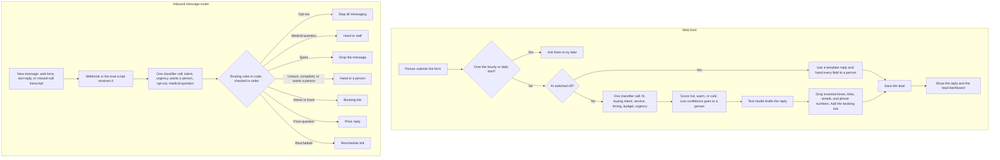

# speed-to-lead-ai

**Reply to every inbound lead in under a second, score it hot/warm/cold, and route anything risky to a human.**

Built as a working demo for a fictional med spa ("Example Med Spa"). Nothing is ever texted or emailed.

## How it works

Two paths share one rule: one classification call reads the message, then ordinary code picks the next step. Nothing is texted or emailed.



## The problem
Local service businesses (med spas, home services, clinics) pay for clicks, then let web-form leads sit for hours. Most leads book with whoever answers first. The owners don't need a chatbot; they need a reply within seconds that (a) knows what the person asked for, (b) never promises a slot the calendar can't honor, and (c) hands off opt-outs, complaints, and medical questions to staff.

## What it does
Two pieces that share one idea: **one batched classification call per message, then deterministic code decides.**

1. **`worker/` – Cloudflare Worker landing page + API + dashboard**
   - Web form → one classifier call returns ICP fit, buy intent, service, timeframe, budget band, and urgency, each with a confidence.
   - Score band = avg(icp_fit, buy_intent): ≥0.7 hot, ≥0.4 warm, else cold.
   - Any field under 70% confidence is shown as "would go to a human".
   - Workers AI (`llama-3.2-3b-instruct`) drafts the first text. A regex post-check strips any sentence that offers a day, date, or time (the model can't see the calendar) and appends "What day works best for you? [booking link]". Template fallback if the model fails.
   - Cost guards: `AI_ENABLED` kill switch, per-IP hourly limit, global daily cap, capped row storage, IPs stored only as truncated salted hashes.
2. **`sorter/` + `n8n/` – inbound message router (SMS replies, form fills, missed-call transcripts)**
   - Five questions in one call: `intent` (book / price / reschedule / complaint / spam / opt_out), `urgency`, `asks_for_human`, `opt_out_stop`, `medical_question_needs_staff`.
   - Code applies an ordered rule set: opt-out → stop all; medical → staff; spam → drop; low confidence / complaint / wants a human → human; otherwise booking link, price reply, or reschedule link.
   - `build_n8n.py` generates an importable n8n workflow (Webhook → HTTP classify → Code route → Switch with 7 outputs → placeholder nodes to swap for SMS, calendar, Slack, CRM).

## Results (40 hand-labeled example messages)
- **Routing accuracy 37/40 (92.5%)**, set includes slang, typos, Spanish, sarcasm, and mixed intent. Rules were not tuned after the run.
- **Classifier latency:** median 59 ms, p90 73 ms, max 144 ms. ~660 input tokens per message.
- **End-to-end Worker reply:** ~0.8–1.0 s server-side (see `docs/`).
- Misses are documented in `sorter/sample_results.jsonl` (e.g. a frustrated "call me" after a peel went to `staff` instead of `human`, arguably the safer route).

## Run it
**Worker**
```bash
cd worker
npx wrangler d1 create speed-to-lead-demo          # paste the id into wrangler.toml
npx wrangler d1 execute speed-to-lead-demo --remote --file schema.sql
npx wrangler secret put CLASSIFIER_API_KEY
npx wrangler secret put DASHBOARD_TOKEN       # protects /dashboard
npx wrangler deploy
```
Set `CLASSIFIER_API_URL` / `CLASSIFIER_MODEL` in `wrangler.toml`. The classifier contract is `POST {model, state, questions}` → `{answers: {q: {choice|score|p_yes, confidence}}}`; adapt `classifyLead()` for your provider.

**Dashboard access:** `/dashboard` lists every stored submission, so it requires `DASHBOARD_TOKEN`, sent as the `x-dashboard-token` header or `/dashboard?token=...`. If the secret is unset the dashboard returns 401. For real use, put `/dashboard` behind [Cloudflare Access](https://developers.cloudflare.com/cloudflare-one/policies/access/) instead of (or as well as) the token. AI replies are post-filtered: any sentence with a link, email or phone number is dropped.

**Sorter eval**
```bash
cd sorter
cp ../.env.example ../.env   # fill in, then export the vars
python3 sorter.py            # runs testset_example.json, prints accuracy + latency
python3 build_n8n.py         # regenerates ../n8n/speed-to-lead-sorter.n8n.json
```
**n8n:** import `n8n/speed-to-lead-sorter.n8n.json`, set the three `CLASSIFIER_*` env vars (or a Header Auth credential), then:
```bash
curl -X POST <n8n>/webhook/speed-to-lead -H 'Content-Type: application/json' \
  -d '{"channel":"sms","message":"cant make it tmrw can we push it"}'
```

## Example output
`POST /api/lead` with `{"name":"Jane Doe","contact":"(555) 010-2030","message":"Want botox before my wedding on the 14th, budget around 500"}`:
```json
{
  "response_ms": 850,
  "score": "hot",
  "score_detail": {"label": "hot", "icp_fit": 0.97, "buy_intent": 0.91, "status": "ok"},
  "fields": {
    "service":   {"value": "Botox",    "confidence": 1.0,  "status": "ok"},
    "timeframe": {"value": "This month","confidence": 0.77, "status": "ok"},
    "budget":    {"value": "200-500",  "confidence": 0.99, "status": "ok"},
    "urgency":   {"value": "high",     "confidence": 0.96, "status": "ok"}
  },
  "reply": "Hi Jane! Congrats on the wedding. We'd love to help you look your best with Botox. What day works best for you? You can also grab a time here: [booking link]"
}
```
Sorter line (`sorter/sample_results.jsonl`):
```json
{"channel":"sms","text":"cant make it tmrw, can we push it","expected":"reschedule_link","route":"reschedule_link","correct":true,"latency_s":0.058}
```
Screenshots: `docs/form.png`, `docs/dashboard.png`. Every name in the screenshots and examples is the placeholder Jane Doe. Phone numbers use the fictional 555 exchange.

## Design choices
- **Model reads, code decides.** Routing, opt-out handling, and time slots live in code so they are testable and auditable.
- **Fail toward a human.** Any error, low confidence, or kill-switch state routes to a person, never to silence.
- **Compliance by default.** Opt-out is checked first, including sarcastic and Spanish phrasing.

## License
MIT
